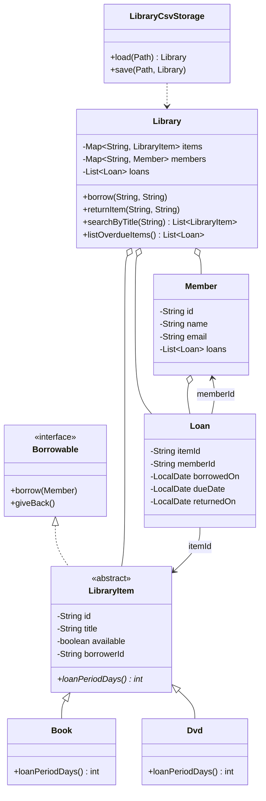

# Library Management System

A Java 17 console mini-project demonstrating encapsulation, inheritance,
abstraction, interfaces, polymorphism, collections, streams, exceptions, and
CSV persistence.

## Run

From the project directory:

```text
mvn package
java -jar target/library-management-system.jar
```

The application creates a `data` directory in the current working directory.
It loads and saves `items.csv`, `members.csv`, and `loans.csv` there. To use a
different data directory, pass it as the first argument:

```text
java -cp target/classes library.LibraryApp C:\library-data
```

Choose **0. Save and exit** to persist changes. Items support 21-day book loans
and 7-day DVD loans. A member may have at most three active loans.

## Class diagram



## Short report

`LibraryItem` encapsulates shared item state and is abstract so each subtype
supplies its loan period. `Book` and `Dvd` provide distinct periods, and the
library uses the declared subtype's `loanPeriodDays()` when calculating each
loan's due date. Items implement `Borrowable` to own their availability
transitions. `Member` and `Loan` validate their state, while the `Library`
service enforces unique IDs, item availability, and the three-active-loan
limit with the two custom checked exceptions.

The service stores items and members in maps keyed by ID, and title searches
and overdue reports use streams. Persistence writes separate CSV files for
items, members, and loan history. On startup the data is reloaded, and active
loans restore the corresponding unavailable item state. CSV fields are quoted
and escaped when needed. Invalid persisted rows report the file and line
number rather than being silently ignored.
